<p align="center">
  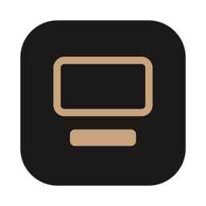
</p>

<h1 align="center">DashUp</h1>

<p align="center">
  An iPad companion for your Mac. Keep it below your monitor to see and steer what your Mac is doing:<br>
  Claude Code sessions, your apps, Chrome, whatever's playing, and a pad of one-tap actions.
</p>

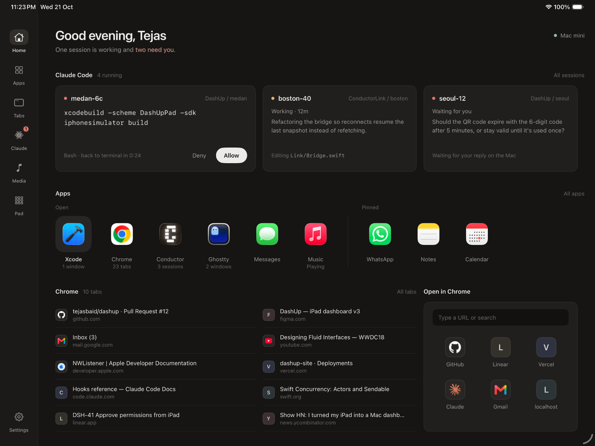

DashUp is two native apps that talk over your local network:

- **DashUp for Mac** is a small menu bar app. It reads your Claude Code sessions, apps, Chrome tabs and Now Playing, runs the actions you tap, and receives Claude Code hooks.
- **DashUp for iPad** is a SwiftUI app designed for a desk: warm and dark, glanceable from arm's length, and calm when nothing needs you.

## What it does

### Claude Code, at a glance

Every running session, led by what it's working on. Each card shows what the session is doing right now, the last thing it said, and how many steps it has taken and files it has changed. When a session wants permission to run something, the command shows up full width with **Allow** and **Deny**, and your answer goes straight back to Claude Code.

| Sessions | Session detail |
|---|---|
| 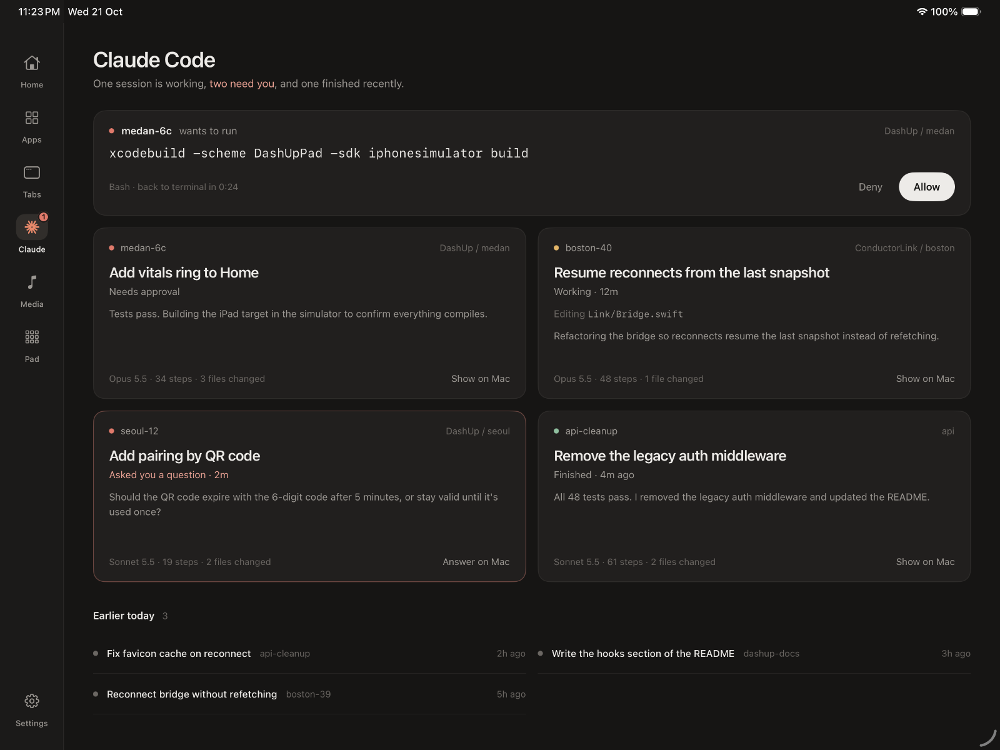 | 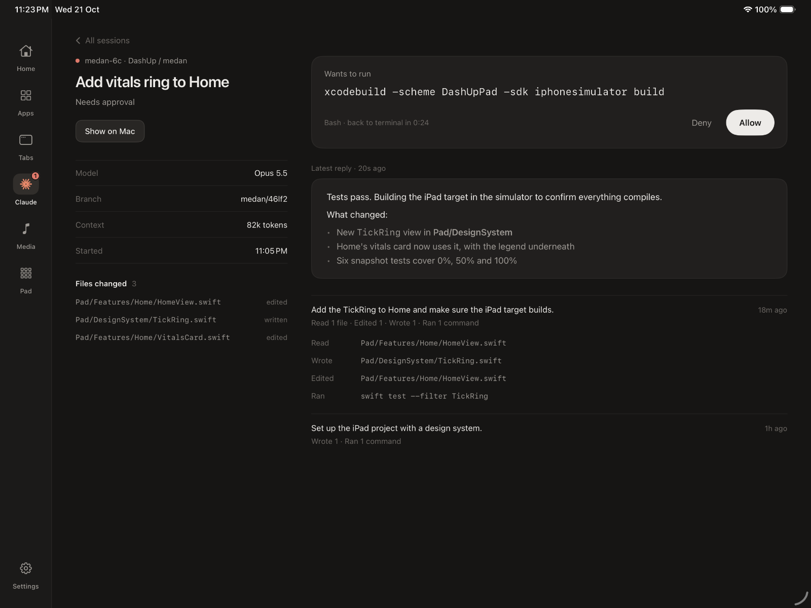 |

Tap a session to read its latest reply (rendered Markdown), see the files it changed, and follow its work grouped by the prompts you gave it. Sessions that ended in the last 12 hours stay listed under **Earlier today**.

If no iPad is connected, or you don't answer within 45 seconds, Claude Code asks in the terminal as usual. Nothing ever gets stuck waiting on the iPad.

### Standby

After a few idle minutes the iPad dims to a desk clock. When a session needs approval, a coral glow rises from the bottom and you can answer right there, without waking the screen.

| Needs you | Calm |
|---|---|
| 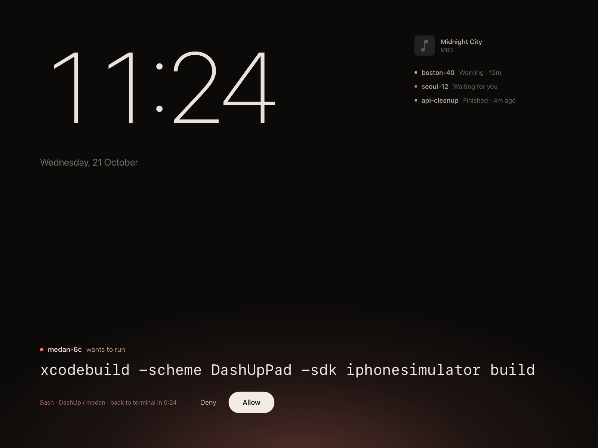 | 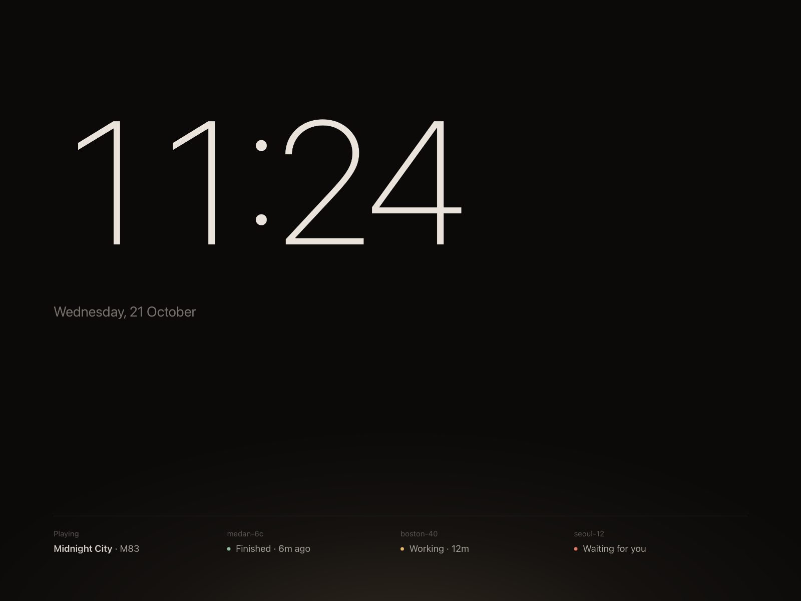 |

### Pad

A Stream Deck–style grid of keys. Modes are toggles that read their state from the Mac (Stay awake, Dark mode, mic and sound). Project keys run shell commands and show their result ("48 passed · 2m ago"). Mac keys trigger system actions such as Lock, Screenshot and Mission Control. Pages and keys are defined in a JSON file on the Mac; see [Configuring the Pad](#configuring-the-pad).

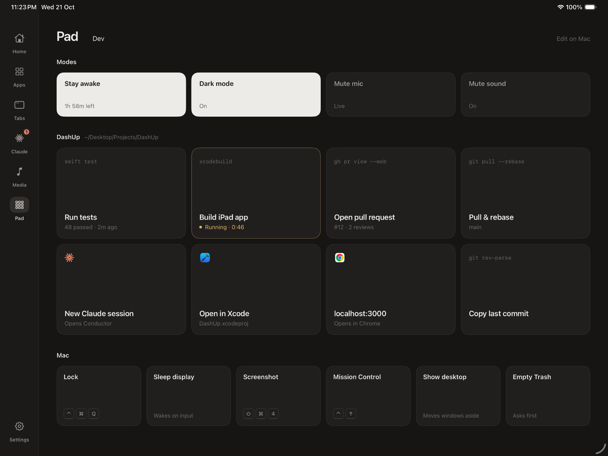

### Apps, Chrome and Media

| Apps | Chrome tabs |
|---|---|
| 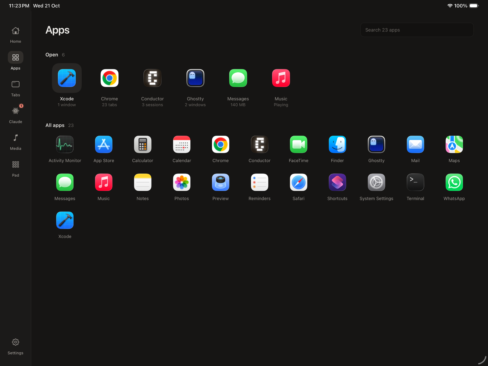 | 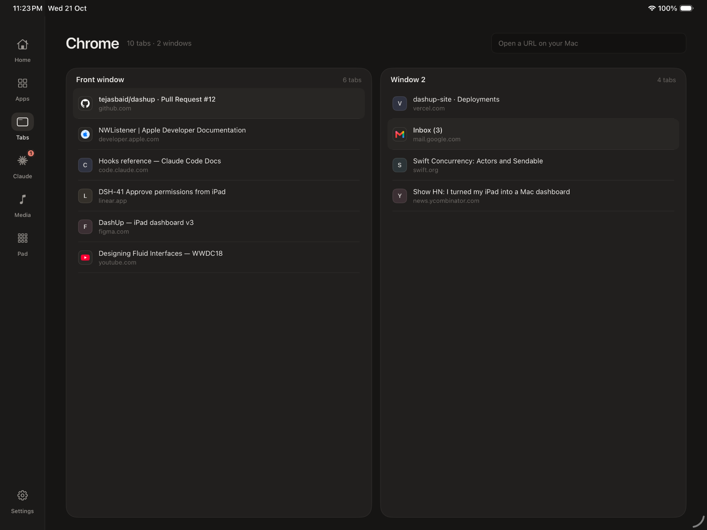 |

- **Apps.** See what's open, with a live detail under each app (tab counts, Claude sessions in Conductor, what's playing). Tap to switch or launch; long-press to hide, quit or pin to Home.
- **Chrome.** Every window and tab, with real favicons. Tap a tab to bring it to the front on the Mac, long-press to close it, or type a URL or search to open it in Chrome.
- **Media.** Whatever macOS is playing, from Spotify, YouTube in Chrome or Safari, Podcasts or Music, with artwork, scrubbing, skip and volume.

| Media | Settings |
|---|---|
| 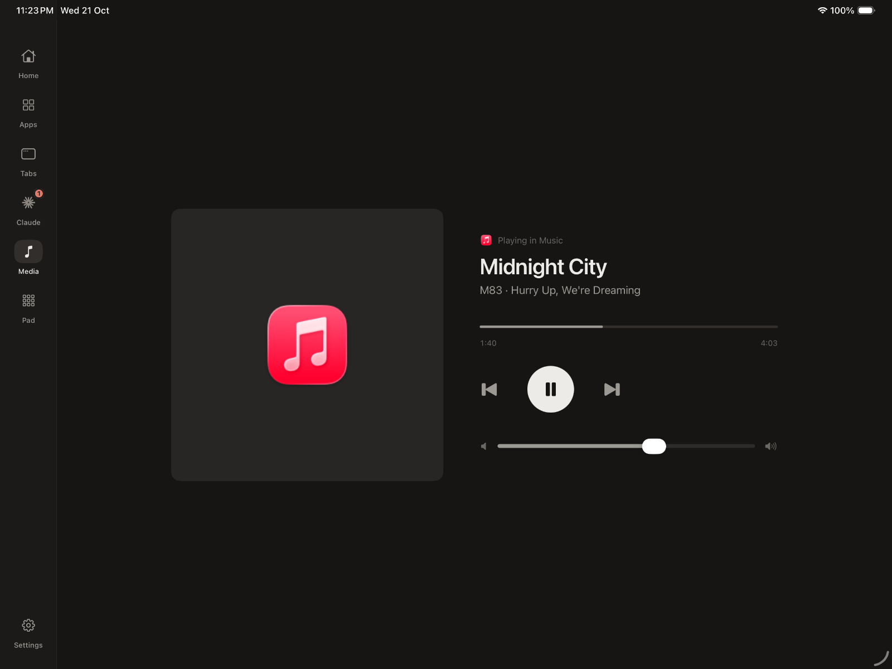 | 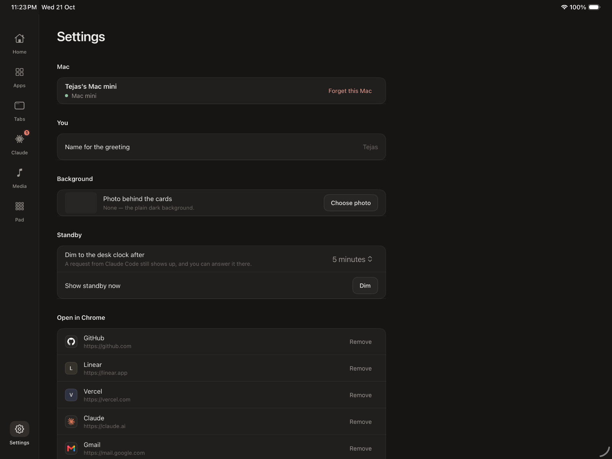 |

**Settings** has your name for the greeting, the standby timer, the quick-open sites on Home, and an optional **background photo** behind the cards. Cards turn frosted over it, and Dim and Blur sliders keep text readable.

## Requirements

- A Mac running macOS 26 with Xcode 26.
- An iPad running iPadOS 26.
- The Mac and iPad on the same network. Peer-to-peer Wi-Fi also works.
- [XcodeGen](https://github.com/yonaskolb/XcodeGen) (`brew install xcodegen`) if you add or move files.

## Getting started

```sh
git clone https://github.com/TejasBaid/dashup.git
cd dashup
open DashUp.xcodeproj        # or: xcodegen generate && open DashUp.xcodeproj
```

### 1. Run the Mac app

Run the **DashUpMac** scheme. A monitor icon appears in the menu bar; everything is controlled from there.

- **Connect Claude Code** adds HTTP hooks to `~/.claude/settings.json`, so sessions report live activity and ask your iPad for approval. Your existing hooks are kept, and the previous file is saved as `settings.json.dashup-backup`. **Turn off** removes exactly what was added.
- **Open at login** starts DashUp with your Mac. Move `DashUp.app` to `/Applications` first.
- **Edit Pad…** opens the Pad's JSON file.

### 2. Install on the iPad

1. In Xcode, add your Apple ID under **Settings → Accounts**, then choose your team under **DashUpPad → Signing & Capabilities**. A free Apple ID works, but the app has to be reinstalled every 7 days.
2. Connect the iPad, turn on **Developer Mode** (Settings → Privacy & Security), and run the **DashUpPad** scheme on it.

### 3. Pair

On the Mac, choose **Pair an iPad…** from the menu bar and type the 6-digit code on the iPad. The code is valid for five minutes. After pairing, the iPad reconnects on its own whenever both are on the network.

### Permissions on the Mac

macOS asks once for each of these, the first time they're needed:

| Permission | Used for |
|---|---|
| Automation → Google Chrome | Listing, focusing and closing tabs; opening URLs |
| Automation → System Events | Dark mode toggle |
| Automation → Music | Fallback Now Playing, only if the MediaRemote bridge can't run |
| Automation → Finder | Empty Trash key |
| Accessibility | Keyboard-shortcut keys (Lock, Screenshot) |

## How it works

```
 ┌──────────────────────────────────────┐            ┌────────────────────────────────────────────────────────┐
 │ iPad                                 │            │ Mac (menu bar agent)                                   │
 │                                      │            │                                                        │
 │ Home · Claude · Tabs · Apps          │ Bonjour    │ PeerServer  _dashup._tcp, TLS + PSK                    │
 │ Media · Pad · Standby · Settings     │ ──────▶    │ HookServer  127.0.0.1:47823                            │
 │                                      │ ◀──────    │             ▲ Claude Code HTTP hooks                   │
 │ MacLink: find, pair, reconnect       │ state +    │ Providers   Claude · Apps · Chrome ·                   │
 │                                      │ actions    │             Now Playing · Pad                          │
 └──────────────────────────────────────┘            └────────────────────────────────────────────────────────┘
```

- **Transport.** The Mac advertises `_dashup._tcp` over Bonjour. Every connection is TLS with a pre-shared key, so only paired devices can connect and all traffic is encrypted. Messages are length-prefixed JSON. Each topic (Claude, apps, Chrome, Now Playing, Pad) is pushed as full state whenever it changes, and actions are request/response. The iPad sends a heartbeat so the Mac notices dropped connections quickly.
- **Pairing.** A separate `_dashup-pair._tcp` listener runs only while a code is showing. Its key is derived from the code. Over that channel the Mac hands the iPad the long-lived secret, which the iPad keeps in its Keychain and the Mac keeps in `~/Library/Application Support/DashUp/secret` (mode 0600).
- **Claude Code.** The agent merges three sources:
  - `~/.claude/sessions/<pid>.json`, Claude Code's list of live sessions. The `*.key` files next to them are never read.
  - Each session's transcript, read incrementally for its title, messages, tool timeline, step count and changed files.
  - HTTP hooks, for instant activity and permission requests.
- **Approvals.** The `PermissionRequest` hook is held open until you tap Allow or Deny, for up to 45 seconds. If nobody answers, or no iPad is connected, the agent replies `{}` and Claude Code falls back to its normal terminal prompt. If the agent isn't running, the hook simply fails and Claude Code carries on as usual.
- **Chrome.** Windows and tabs come from JavaScript for Automation. Favicons are read from Chrome's own `Favicons` database, so DashUp makes no network requests for them.
- **Now Playing.** Since macOS 15.4, the private MediaRemote framework only answers Apple-signed processes. DashUp builds a tiny bridge library (`Mac/NowPlaying/DashUpMediaRemote.m`) into the app, loads it into the system's `/usr/bin/perl`, and streams JSON back. The bridge exits with the agent. If it can't run, DashUp falls back to scripting Apple Music.
- **Standby.** Touches reset the idle timer. The screen stays awake while connected, and a new approval request shows up in Standby straight away.

## Configuring the Pad

The Pad lives in `~/Library/Application Support/DashUp/pad.json`, created with defaults on first run and reloaded whenever you save it. Each page has sections with a `style` (`modes`, `keys` or `compact`), and each item has exactly one action:

```json
{
  "title": "DashUp",
  "subtitle": "~/Desktop/Projects/DashUp",
  "style": "keys",
  "directory": "~/Desktop/Projects/DashUp",
  "items": [
    { "id": "run-tests", "title": "Run tests", "context": "swift test",
      "shell": "swift test --package-path Packages/DashUpKit" },
    { "id": "localhost", "title": "localhost:3000", "subtitle": "Opens in Chrome",
      "app": "com.google.Chrome", "url": "http://localhost:3000" },
    { "id": "lock", "title": "Lock", "keycaps": ["⌃", "⌘", "Q"], "builtin": "lockScreen" }
  ]
}
```

| Action | Value |
|---|---|
| `shell` | A command, run with `zsh -lc` in the section's `directory`. The key shows the last line of output. |
| `url` | Opened in `app` if set (a bundle ID), else your default browser. |
| `open` | A file or folder path, optionally with `app`. |
| `launch` | A bundle ID to launch or switch to. |
| `toggle` | `stayAwake`, `darkMode`, `muteMic`, `muteSound` |
| `builtin` | `lockScreen`, `sleepDisplay`, `screenshot`, `missionControl`, `showDesktop`, `emptyTrash`, `playPause`, `nextTrack`, `previousTrack`, `volumeUp`, `volumeDown` |
| `shortcut` | The name of a Shortcuts shortcut. |

Optional fields:

| Field | Effect |
|---|---|
| `subtitle` | A line of text under the title. |
| `context` | A small monospaced line on the key. |
| `app` | The bundle ID whose icon appears on the key. |
| `keycaps` | Keyboard keys drawn on the key. |
| `confirm` | Asks before running. |

## Project layout

| Path | |
|---|---|
| `Mac/` | The menu bar agent: `App/` (menu UI, wiring), `Server/` (iPad server, hook server, hook installer), `Providers/` (Claude, Apps, Chrome, Now Playing, Pad), `NowPlaying/` (MediaRemote bridge). |
| `Pad/` | The iPad app: `Model/` (connection, state, image cache, demo data), `DesignSystem/`, `Features/` (one folder per screen). |
| `Packages/DashUpKit/` | Shared models and wire protocol, the TLS transport, and `dashup-cli`, a headless client for testing the agent. |
| `PadUITests/` | UI tests that capture screenshots and run the live pair-and-approve flow. |
| `Tools/` | `sim.sh` (simulator helpers), `e2e.sh` (end-to-end test), `make-icons.swift`. |
| `project.yml` | XcodeGen spec. Run `xcodegen generate` after adding files. |

## Development and testing

```sh
# Protocol, formatting, and a real encrypted loopback connection (including wrong-key rejection)
swift test --package-path Packages/DashUpKit

# Run the agent with a fixed pairing code. Testing only: it leaves pairing open.
DASHUP_PAIR_CODE=424242 .build/xcode/Build/Products/Debug/DashUp.app/Contents/MacOS/DashUp &

# Talk to it without an iPad
swift build --package-path Packages/DashUpKit
Packages/DashUpKit/.build/debug/dashup-cli pair 424242
Packages/DashUpKit/.build/debug/dashup-cli watch              # stream state
Packages/DashUpKit/.build/debug/dashup-cli allow <request-id> # answer a permission request

# End to end: the simulator iPad pairs, a permission request is fired, and the UI test taps Allow
Tools/e2e.sh
```

**Demo mode.** The iPad app has a demo mode with sample data, no Mac needed: launch it with `-demo`, optionally adding `-screen claude|tabs|apps|media|pad|settings`, `-claudeDetail s1`, `-standby` or `-standby -calm`. The `testScreenshots` UI test captures every screen this way; it's how the screenshots above were made.

## Known limitations

- **Signing.** The Mac app is signed ad hoc, so macOS may ask for Automation permissions again after a rebuild.
- **Approvals while a request is pending.** Whether the terminal also shows its own prompt while the iPad is deciding hasn't been verified in an interactive Claude Code session.
- **Volume.** The Media screen's volume slider controls the Mac's output volume, not the playing app's own volume.
